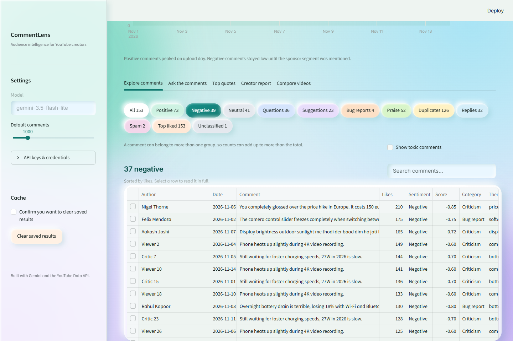

# CommentLens

Audience intelligence and comment classification for YouTube creators.

## Problem Statement

YouTube creators often receive thousands of comments across their videos. Manually reading, categorizing, and synthesizing this volume of audience feedback is time-prohibitive. Consequently, creators frequently miss critical viewer questions, urgent bug reports, valuable content suggestions, and broader shifts in community sentiment. CommentLens automates this process by retrieving video comments, classifying them using Google Gemini, and presenting organized, actionable insights in a clean interface.

## Features

- Palettes with counts: 14 segmented views with dynamic comment counts, including All, Positive, Negative, Neutral, Questions, Suggestions, Bug reports, Praise, Duplicates, Replies, Spam, Rude or toxic, Top liked, and Unclassified.
- Sentiment score: Overall audience reception scored on a 0 to 100 scale, paired with a qualitative sentiment indicator (such as "Mostly positive").
- Summary: Concise natural-language paragraph synthesized by Google Gemini outlining overall audience reception and prominent discussion points.
- Theme bars: Horizontal distribution chart visualizing the most frequent topical clusters identified across the dataset.
- Timeline: Temporal distribution chart tracking positive, neutral, and negative comment volume over the lifecycle of the video.
- Row detail panel: Interactive inspection drawer displaying full comment metadata, classification tags, confidence indicators, and an AI-generated suggested reply with one-click copying.
- Ask the comments with cited IDs: Interactive inquiry module enabling creators to query the comment dataset and receive grounded answers with specific bracketed citation identifiers (such as [c12] or [c45]).
- Top quotes: Curated selection of representative, high-signal viewer quotes with toxic remarks excluded and word counts bounded for clarity.
- Creator report: Downloadable, publication-ready Markdown report organizing executive summary metrics, sentiment breakdown tables, top themes, bug reports, and recommended actions.
- CSV export with Excel-safe UTF-8: Full dataset export formatted in UTF-8 with Byte Order Mark (UTF-8 BOM), ensuring proper rendering of non-Latin scripts (such as Hindi and Bengali) and symbols in spreadsheet tools like Microsoft Excel.
- Local cache: Automated local JSON persistence in the cache directory, allowing instantaneous re-inspection of previously analyzed videos without consuming additional API quotas.
- Demo mode: Zero-configuration demo dataset loaded directly from pre-classified samples, enabling complete exploration of all platform capabilities without entering API keys.

## Screenshots




## Tech Stack

- Python 3.11+
- Streamlit
- Google Gemini API (google-genai)
- YouTube Data API v3 (google-api-python-client)
- pandas
- plotly
- python-dotenv

## Setup in 5 Steps

### Step 1: Clone the repository
```bash
git clone <repository-url>
cd commentlens
```

### Step 2: Install dependencies
```bash
pip install -r requirements.txt
```

### Step 3: Create environment configuration
Copy the template configuration file:
```bash
# Windows (PowerShell)
Copy-Item .env.example .env

# macOS / Linux
cp .env.example .env
```

### Step 4: Add API keys
Open `.env` in a text editor and add your API keys:
```env
YOUTUBE_API_KEY=YOUR_YOUTUBE_KEY_HERE
GEMINI_API_KEY=YOUR_GEMINI_KEY_HERE
```
Alternatively, keys can be entered directly in the running application sidebar under Settings -> API keys & credentials.

### Step 5: Launch the application
```bash
python -m streamlit run app.py
```

The application will start locally at `http://localhost:8501`.

## Obtaining API Keys

### Google Gemini API
1. Visit Google AI Studio at https://aistudio.google.com/
2. Sign in with your Google account.
3. Select "Get API key" and click "Create API key".
4. Copy the generated key and assign it to `GEMINI_API_KEY`.

### YouTube Data API v3
1. Visit the Google Cloud Console at https://console.cloud.google.com/
2. Create a new project or select an existing one.
3. Navigate to "APIs & Services" > "Library".
4. Search for "YouTube Data API v3" and click "Enable".
5. Navigate to "APIs & Services" > "Credentials".
6. Click "Create Credentials" > "API key".
7. Copy the generated key and assign it to `YOUTUBE_API_KEY`.

## Running Tests

The test suite validates URL parsing, comment sanitization, duplicate detection, batch generation, schema enforcement, palette categorization, citation parsing, report generation, and CSV encoding.

Execute tests using pytest:
```bash
python -m pytest tests/test_all.py -v
```

## Project Structure

```
commentlens/
|-- app.py                  # Streamlit application entry point and interface logic
|-- styles.css              # Custom styling definitions and typography rules
|-- requirements.txt        # Python package dependencies
|-- .env.example            # Environment variable template with placeholder keys
|-- .gitignore              # Git ignore patterns for local environments and caches
|-- README.md               # Project documentation
|-- .streamlit/
|   `-- config.toml         # Streamlit server and theme configuration
|-- core/
|   |-- __init__.py         # Package indicator
|   |-- youtube.py          # YouTube Data API client and video URL parsing
|   |-- cleaning.py         # Text cleaning, emoji normalization, duplicate detection
|   |-- classifier.py       # Gemini batch classification, schemas, and summarization
|   |-- analysis.py         # Statistical calculations, timeline, and palette filters
|   |-- creator.py          # Grounded Q&A citations, quote filtering, report formatting
|   |-- export.py           # Excel-compatible UTF-8 BOM CSV export handling
|   `-- cache.py            # Local JSON cache management
|-- cache/                  # Persisted video analysis JSON files
|-- docs/                   # Documentation assets and screenshots
`-- tests/
    `-- test_all.py         # Unit and integration test suite
```

## Privacy Note

Comments retrieved from public YouTube videos are submitted to Google Gemini API for classification and synthesis. All processed datasets and analysis results are stored solely in the local `cache/` directory on your machine. No comment data or audience information is sent to third-party tracking services or external databases.

## License

MIT License

Copyright (c) 2026 Your Name

Permission is hereby granted, free of charge, to any person obtaining a copy of this software and associated documentation files (the "Software"), to deal in the Software without restriction, including without limitation the rights to use, copy, modify, merge, publish, distribute, sublicense, and/or sell copies of the Software, and to permit persons to whom the Software is furnished to do so, subject to the following conditions:

The above copyright notice and this permission notice shall be included in all copies or substantial portions of the Software.

THE SOFTWARE IS PROVIDED "AS IS", WITHOUT WARRANTY OF ANY KIND, EXPRESS OR IMPLIED, INCLUDING BUT NOT LIMITED TO THE WARRANTIES OF MERCHANTABILITY, FITNESS FOR A PARTICULAR PURPOSE AND NONINFRINGEMENT. IN NO EVENT SHALL THE AUTHORS OR COPYRIGHT HOLDERS BE LIABLE FOR ANY CLAIM, DAMAGES OR OTHER LIABILITY, WHETHER IN AN ACTION OF CONTRACT, TORT OR OTHERWISE, ARISING FROM, OUT OF OR IN CONNECTION WITH THE SOFTWARE OR THE USE OR OTHER DEALINGS IN THE SOFTWARE.
