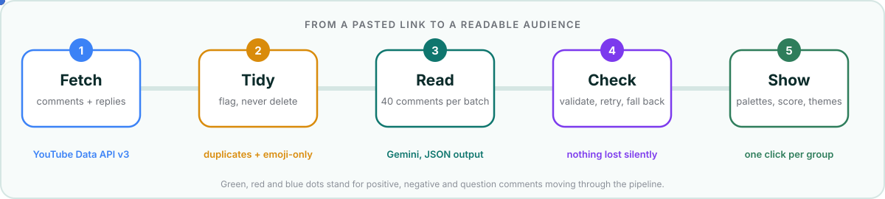
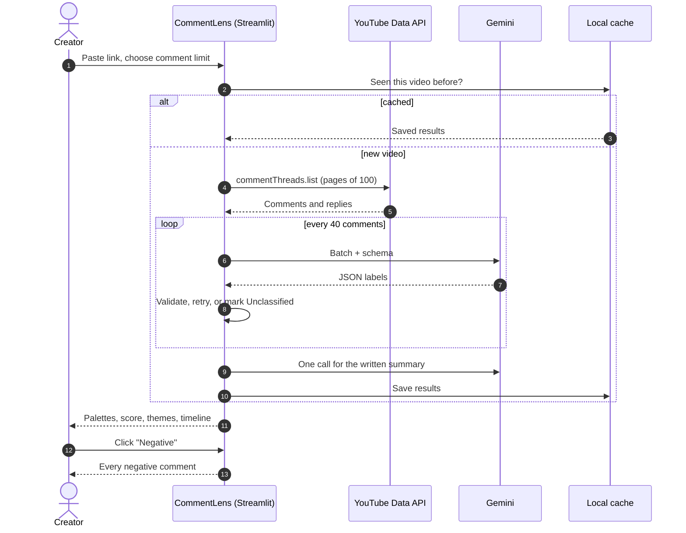
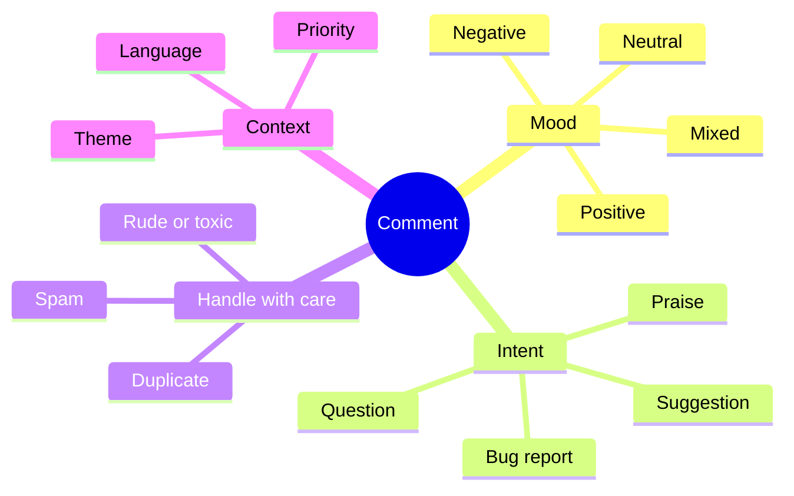

<div align="center">


<br/>

[](https://www.python.org/)
[](https://streamlit.io/)
[](https://aistudio.google.com/)
[](https://developers.google.com/youtube/v3)


### Paste a link. Click a group. Read the people who watched.

[**Try the demo**](#-run-it-in-five-minutes) &nbsp;·&nbsp; [**How it works**](#-how-it-works) &nbsp;·&nbsp; [**Features**](#-what-the-creator-sees) &nbsp;·&nbsp; [**Architecture**](#-architecture) &nbsp;·&nbsp; [**Roadmap**](#-roadmap)

</div>

---

## The problem, in one morning

> It is 9 a.m. The video went live last night. There are **4,200 comments**. The first 60 are "first!" and emojis.
> Somewhere below is the comment that explains why the second half lost viewers, and another asking for the part 2 everyone is waiting for.

Likes and views say **how many** people watched. They do not say whether viewers were **confused, delighted, or let down**. Scrolling will not find the signal, and nobody has a week to read it all.

**CommentLens reads every comment for you**, sorts them by meaning, and turns the noise into a short list of things a creator can act on.

<div align="center">

| Without CommentLens | With CommentLens |
|:--|:--|
| Scroll for hours, read a fraction | Every comment read and labelled |
| Guess the mood from likes | A 0 to 100 sentiment score with a plain label |
| Miss the bug report on page 40 | Bug reports are one click away |
| Answer the same question 50 times | Questions grouped, with suggested replies |
| Trolls ruin the morning | Toxic comments hidden by default |

</div>

---

## 🎬 The idea in one picture

<div align="center">

</div>

<sub>An illustration of the interface with example numbers. Each pill is a group of comments. Click one to open it, click it again to return to all comments.</sub>

---

## 🔁 How it works

<div align="center">

</div>

<br/>

| Step | What happens | Why it matters |
|:--:|:--|:--|
| **1. Fetch** | The YouTube Data API returns comments and replies, up to the limit you set. | No scraping, no login, just an API key. |
| **2. Tidy** | Empty comments are dropped. Repeats are **flagged and counted, never deleted**. | You can see when 100 people say the same thing. |
| **3. Read** | Gemini reads **40 comments per request** and returns strict JSON labels. | Fewer requests, so it fits free-tier limits. |
| **4. Check** | Every answer is validated, retried on failure, and falls back to another model if needed. | Failed comments land in an **Unclassified** group instead of vanishing. |
| **5. Show** | Counts, score, themes, and timeline are computed locally and shown as palettes. | One click from a number to the comments behind it. |

---

## 🧭 Architecture

```mermaid
flowchart LR
    U([Creator pastes a link]):::start --> K{Already in cache?}:::decide
    K -- yes --> D
    K -- no --> F

    subgraph FETCH [" 1 · Fetch "]
      F["Extract video ID"]:::fetch --> Y["YouTube Data API v3<br/>comments and replies"]:::fetch
    end

    subgraph PREP [" 2 · Tidy "]
      Y --> C["Drop empty text"]:::tidy --> DU["Flag duplicates<br/>Flag emoji-only"]:::tidy
    end

    subgraph READ [" 3 · Read and 4 · Check "]
      DU --> B["Batches of 40"]:::ai --> G["Gemini<br/>structured JSON"]:::ai
      G --> V{"Valid?"}:::decide
      V -- no, retry with backoff --> G
      V -- no, retries used up --> UN["Unclassified group"]:::warn
      V -- yes --> R["Labelled comments"]:::ok
    end

    R --> A["Counts, score, themes, timeline"]:::ok
    UN --> A
    A --> S[("Save to local cache")]:::store
    S --> D

    subgraph SHOW [" 5 · Show "]
      D["Dashboard"]:::ui --> P["Palettes and table"]:::ui
      D --> Q["Ask the comments"]:::ui
      D --> X["Creator report and CSV"]:::ui
    end

    classDef start fill:#0F766E,stroke:#0F766E,color:#fff
    classDef fetch fill:#DBEAFE,stroke:#3B82F6,color:#1E3A8A
    classDef tidy fill:#FEF3C7,stroke:#D98B0B,color:#78350F
    classDef ai fill:#CCFBF1,stroke:#0F766E,color:#134E4A
    classDef ok fill:#DCFCE7,stroke:#2E7D5B,color:#14532D
    classDef warn fill:#FEE2E2,stroke:#B23B3B,color:#7F1D1D
    classDef decide fill:#EDE9FE,stroke:#7C3AED,color:#4C1D95
    classDef store fill:#F3F4F6,stroke:#8A8F98,color:#374151
    classDef ui fill:#FFFFFF,stroke:#0F766E,color:#0B2B2A
```



### A request, step by step



---

## 🎨 What the creator sees

<table>
<tr>
<td width="50%" valign="top">

### 🟢 Palettes with counts
Positive, Negative, Neutral, Questions, Suggestions, Bug reports, Praise, Duplicates, Replies, Spam, Top liked, and Unclassified. One click opens a group, a second click closes it.

### 🌡️ Mood score
A single number from 0 to 100 with a plain label: **mostly negative**, **mixed**, or **mostly positive**.

### 📝 Written summary
A few plain sentences on what viewers liked, what they criticised, and what they asked for.

### 🏷️ Theme bars
The most common topics inside suggestions and criticism, such as *audio quality*, *pacing*, or *part 2 request*.

</td>
<td width="50%" valign="top">

### 📈 Timeline
Positive and negative reactions by day, so a mood drop after a sponsor segment shows up.

### 🗂️ Detail drawer
Click any row to see the full comment, every label, a one-line summary, and a reply you can copy.

### 💬 Ask the comments
Ask in plain words: *"What do viewers want next?"* The answer **cites the comment IDs it used**, so every claim can be checked.

### 🆚 Compare videos
Put two videos side by side: sentiment, volume, and themes.

</td>
</tr>
</table>

<details>
<summary><b>🛡️ Safety and honesty features (click to open)</b></summary>

<br/>

- **Toxic comments are hidden by default** and never quoted in summaries or the top-quotes list. A checkbox reveals them when needed.
- **Nothing is silently dropped.** If Gemini fails on a batch, those comments appear in an Unclassified group with a message saying how many.
- **Answers are grounded.** The Ask panel only uses comment text and shows the cited comments under each answer. It is told not to invent facts about the video.
- **No raw errors.** Problems such as an invalid link, comments turned off, a missing key, or a rate limit appear as plain sentences, and secrets are stripped from messages.

</details>

---

## 🏷️ What every comment is labelled with

A comment can be several things at once, so labels are **flags**, not a single box. A question can also be negative, and it will appear in both groups.

<div align="center">

| Label | Values |
|:--|:--|
| Sentiment | `Positive` · `Negative` · `Neutral` · `Mixed` |
| Score | a number from −1.0 to 1.0 |
| Category | `Praise` · `Criticism` · `Question` · `Suggestion` · `Bug report` · `Rude or toxic` · `Spam` · `Off-topic` · `Other` |
| Flags | `is_question` · `is_suggestion` · `is_bug_report` · `is_praise` · `is_criticism` · `is_rude_or_toxic` · `is_spam_or_bot` · `is_off_topic` |
| Theme | one to three words, for example *audio quality* |
| Language | `English` · `Hindi` · `Bengali` · `Hinglish` · `Other` |
| Priority | `High` · `Medium` · `Low` |
| Extras | one-line summary, suggested reply, duplicate count |

</div>



---

## 🧪 Built to survive a live demo

| Situation | What CommentLens does |
|:--|:--|
| No API keys yet | **Demo mode** loads a built-in multilingual sample, no keys needed. |
| Same video twice | Loads from the **local cache**, with zero API calls. |
| Gemini model is busy | Retries with backoff, then falls back to another model. |
| A batch keeps failing | The rest still show. Failed comments go to **Unclassified**. |
| Comments turned off | Shows: *"Comments are turned off for this video."* |
| Key typed wrongly | Explains which key is wrong, with no stack trace and no leaked key. |
| Opening the CSV in Excel | Hindi and Bengali display correctly (UTF-8 with BOM). |

Run the **13 automated tests** with `python -m pytest tests/test_all.py -v`. They cover link parsing, cleaning, duplicate flags, batching, schema validation, palette filters, scoring, citations, reports, and CSV export.

---

## 🧰 Tech stack

<div align="center">

| Layer | Choice | Reason |
|:--|:--|:--|
| Interface | **Streamlit** | Tables, charts, and tabs with little code |
| AI | **Google Gemini** via `google-genai` | Free tier and structured JSON output |
| Data | **YouTube Data API v3** | Official, free, API key only |
| Tables and charts | **pandas**, **Plotly** | Fast filtering and clean charts |
| Settings | **python-dotenv** | Keys stay in `.env`, never in code |
| Storage | **JSON files** in `cache/` | No database to install |

</div>

---

## 🚀 Run it in five minutes

```bash
# 1. Get the code
git clone https://github.com/ashadul-20/commentlens.git
cd commentlens

# 2. Install
pip install -r requirements.txt

# 3. Create your settings file
copy .env.example .env        # macOS/Linux: cp .env.example .env

# 4. Add your keys to .env (see below)

# 5. Run
python -m streamlit run app.py
```

Open **http://localhost:8501**.

> **No keys yet?** Click **Load sample video (demo)** on the first screen to explore the whole dashboard right now.

<details>
<summary><b>🔑 Getting the two API keys (click to open)</b></summary>

<br/>

**Gemini key**
1. Open [Google AI Studio](https://aistudio.google.com/) and sign in.
2. Choose **Get API key** and copy it.

**YouTube Data API key**
1. Open [Google Cloud Console](https://console.cloud.google.com/) and create a project.
2. Go to **APIs & Services → Library**, search for **YouTube Data API v3**, and click **Enable**.
3. Go to **Credentials → Create credentials → API key**. Copy the full key, which starts with `AIza`.

Put them in `.env`:

```env
GEMINI_API_KEY=your_gemini_key
YOUTUBE_API_KEY=your_youtube_key
```

You can also paste both keys in the app under **Settings → API keys & credentials** in the sidebar.

</details>

---

## 🗂️ Project layout

```text
commentlens/
├── app.py                 the screen you see
├── styles.css             the visual design
├── core/
│   ├── youtube.py         link parsing and comment fetching
│   ├── cleaning.py        tidying, duplicate flags, batching
│   ├── classifier.py      Gemini prompts, validation, retries
│   ├── analysis.py        counts, palettes, score, themes, timeline
│   ├── creator.py         quotes, grounded answers, creator report
│   ├── export.py          Excel-safe CSV
│   └── cache.py           local cache per video
├── tests/test_all.py      13 unit tests
├── docs/                  README images
└── .env.example           key template (no real keys)
```

---

## 🔒 Privacy

- Comment text is sent to **Google Gemini** so it can be read.
- Results are saved only in the local `cache/` folder on your computer.
- Your keys live in `.env`, which Git never uploads.

---

## 🗺️ Roadmap

- [x] Clickable palettes with counts
- [x] Structured Gemini output with validation and retries
- [x] Sentiment score, summary, theme bars, and timeline
- [x] Detail drawer with suggested replies
- [x] Ask the comments, with cited sources
- [x] Creator report and Excel-safe CSV
- [x] Demo mode and local cache
- [x] Compare two videos
- [ ] Editable reply drafts before copying
- [ ] Alerts when a new upload's mood drops sharply
- [ ] Export the report as PDF

---

## ❓ FAQ

<details>
<summary><b>Does it work with Hindi, Bengali, and Hinglish?</b></summary>
Yes. Comments are classified by meaning, not keywords, and each comment is tagged with its language.
</details>

<details>
<summary><b>Why are duplicates kept instead of removed?</b></summary>
Repeated comments tell you something. A hundred identical requests is a strong signal, so they are marked and counted, and have their own palette.
</details>

<details>
<summary><b>Why can the counts add up to more than the total?</b></summary>
Because one comment can belong to several groups. A comment can be a question and negative, so it shows in both.
</details>

<details>
<summary><b>Will it post replies to YouTube for me?</b></summary>
No. It drafts replies you can copy. It never posts, and never asks you to sign in to Google.
</details>

---

<div align="center">

### Built for creators who deserve to hear their audience.

**MIT License** · Made by [Ashadul](https://github.com/ashadul-20) for a hackathon with Google Gemini and the YouTube Data API

<sub>If CommentLens helps you, a star on the repository is a small and welcome thank you.</sub>

</div>
