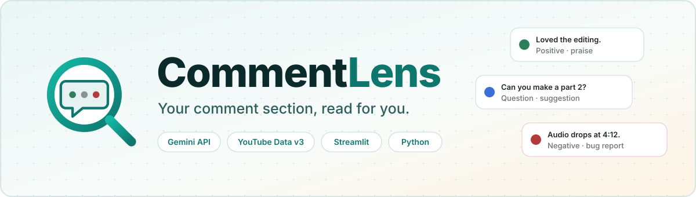
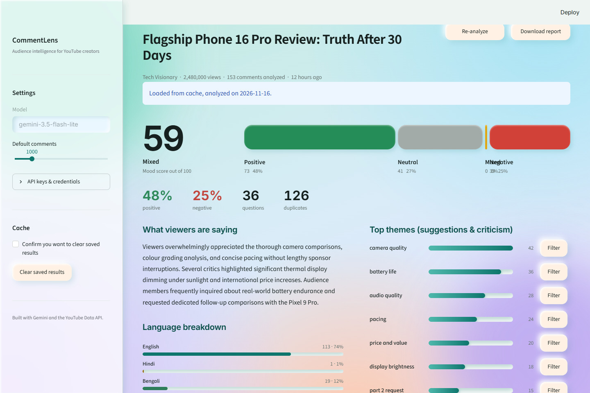
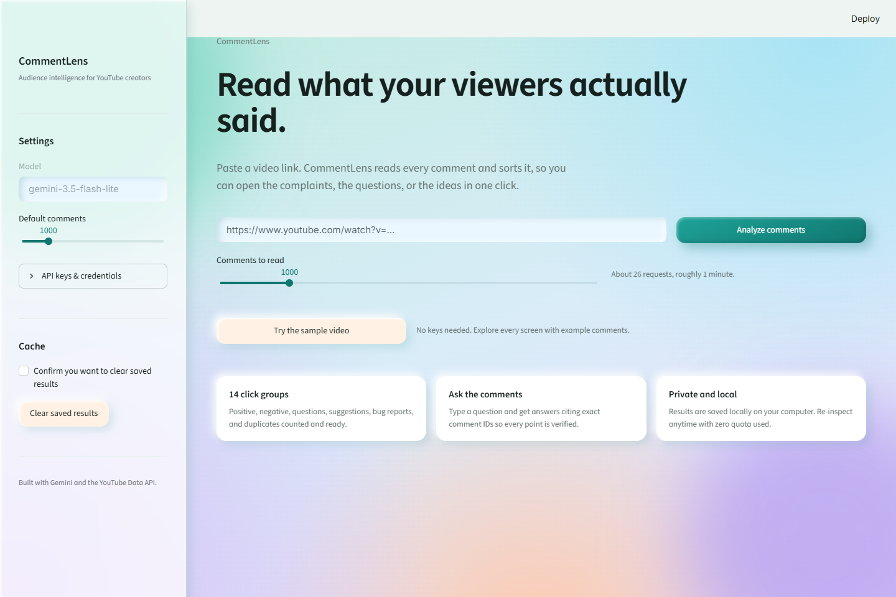
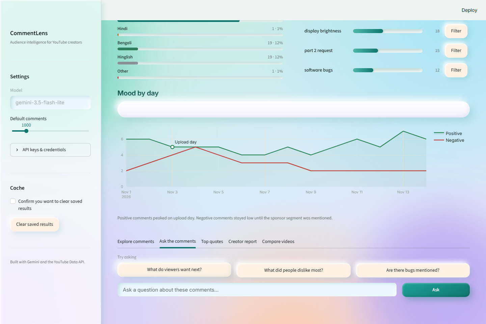
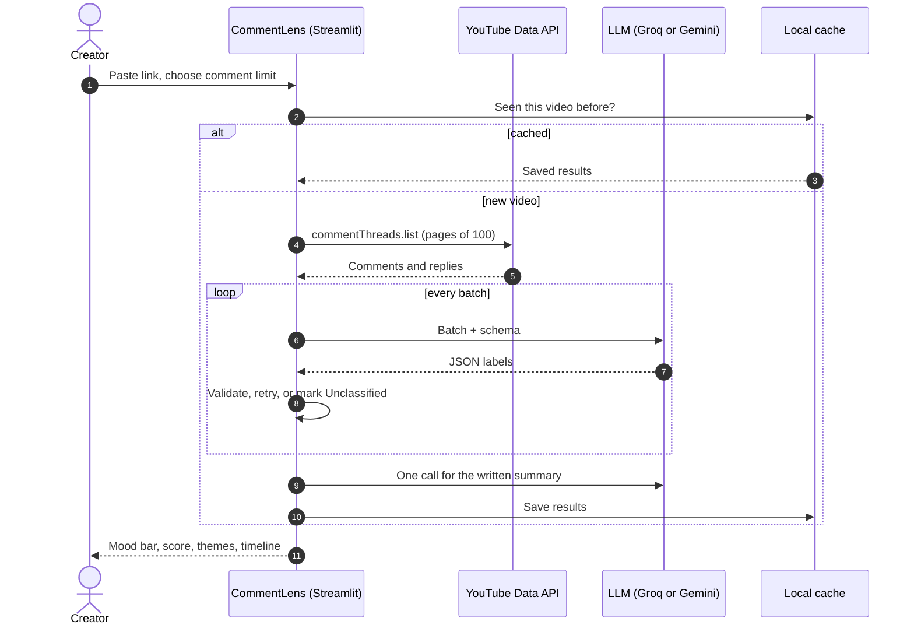

<div align="center">



<br/>

[](https://www.python.org/)
[](https://streamlit.io/)
[](https://console.groq.com/)
[](https://aistudio.google.com/)
[](https://developers.google.com/youtube/v3)


### Paste a YouTube link. Click a group. Read the people who watched.

[**⚡ Try it in 60 seconds**](#try-it-in-60-seconds) &nbsp;·&nbsp; [**🎯 Why it fits the theme**](#why-this-fits-genarrative) &nbsp;·&nbsp; [**🧠 What makes it different**](#what-makes-it-more-than-an-api-wrapper) &nbsp;·&nbsp; [**🧭 Architecture**](#architecture) &nbsp;·&nbsp; [**🗺️ Roadmap (The Remaining 50%)**](#roadmap-the-remaining-50)

</div>

---

## 💡 The Pitch

Creators get thousands of comments and have no time to read them. Likes and views say **how many** people watched, not whether viewers were **confused, delighted, or let down**.

**CommentLens uses GenAI to read every comment, sort it by meaning, and hand the creator a short list of things to act on:** what to fix, what to answer, what to make next.

It is not a chatbot that summarises a page. It is a working tool: a mood bar, clickable groups, a drill-down table, cited answers, and a report the creator can download.

<div align="center">

</div>

---

<a id="try-it-in-60-seconds"></a>
## ⚡ Try it in 60 seconds

> [!TIP]
> **No API keys needed.** Demo mode loads a saved multilingual analysis, so it works offline and never hits a rate limit.

```bash
git clone https://github.com/noobharshu-dev/commentlens.git
cd commentlens
pip install -r requirements.txt
python -m streamlit run app.py
```

Open **http://localhost:8501** and click <kbd>Load sample video (demo)</kbd>. Then try this tour:

| # | Do this | You will see |
|:--:|:--|:--|
| **1** | Look at the top of the dashboard | A mood score out of 100 and a **mood bar** sized by comment count |
| **2** | Click the <kbd>Negative</kbd> pill | Every negative comment, instantly. Click again to go back |
| **3** | Click any row | A drawer with all labels, a one-line summary, and a **suggested reply** |
| **4** | Open **Ask the comments** and ask *"What do viewers want next?"* | An answer that **cites the comment IDs** it used |
| **5** | Open **Creator report** | A written report you can download as Markdown |
| **6** | Open **Diagnostics & logs** | Live pipeline events, latency, and errors |

> [!NOTE]
> **Want it live?** Add a YouTube key and a Groq key (or Gemini) to `.env`, paste any public video link, and it analyses real comments. See [Full setup](#-full-setup).

<!-- TODO: add the demo video link here -->
<!-- 🎥 **Demo video:** https://... -->

---

<a id="why-this-fits-genarrative"></a>
## 🎯 Why this fits GeNarrative

The theme is where **GenAI meets human creativity**. CommentLens supports the creator, it does not replace them.

| What judges look for | How CommentLens answers it |
|:--|:--|
| **Creator support** | Turns audience feedback into actions: bug reports, questions, requests, and a draft reply for each. |
| **Best use of GenAI** | The LLM does the part humans cannot do at scale: reading thousands of comments in English, Hindi, Bengali, and Hinglish by meaning, with strict JSON output. |
| **Human stays in charge** | It **drafts** replies but never posts. Every AI answer cites the real comments behind it, so the creator can check it. |
| **Functionality** | Works end to end today: fetch, classify, dashboard, Ask, report, compare, export. Demo mode and caching make it reliable. |
| **Implementation quality** | Strict schema validation, retries with model fallback, 43 passing tests, live diagnostics. |
| **Innovation** | Labels are **flags, not boxes**, and duplicates are **counted, not deleted**, so creators see what many people are saying. |

---

<a id="what-makes-it-more-than-an-api-wrapper"></a>
## 🧠 What makes it more than an API wrapper

<table>
<tr>
<td width="50%" valign="top">

**1. Nothing is silently dropped**  
Every answer from the model is validated and retried. If a batch still fails, those comments go to an **Unclassified** group with a message saying how many. The dashboard never pretends it read something it did not.

**2. Grounded answers**  
*Ask the comments* only uses comment text, is told not to invent facts about the video, and shows the cited comments under each answer.

**3. Built for free-tier limits**  
Comments are sent in small batches, and if a model is rate-limited the request retries and falls back to the next model, which has its own quota. A batch that still fails never crashes the run.

</td>
<td width="50%" valign="top">

**4. Repeats are a signal**  
A hundred identical requests for "part 2" is the most useful thing in a comment section. Duplicates are flagged and counted, with their own group.

**5. Safe by default**  
Toxic comments are hidden and never quoted in summaries or top quotes.

**6. Built for India's creators**  
Comments are tagged `English`, `Hindi`, `Bengali`, `Hinglish`, or `Other`, and the CSV export opens correctly in Excel (UTF-8 with BOM).

</td>
</tr>
</table>

---

<a id="architecture"></a>
## 🧭 Architecture

```mermaid
flowchart LR
    U([Creator pastes a link]):::start --> K{Already in cache?}:::decide
    K -- yes --> D
    K -- no --> F

    subgraph FETCH [" 1 · Fetch "]
      F["Extract video ID"]:::fetch --> Y["YouTube Data API v3<br/>comments and replies"]:::fetch
    end

    subgraph PREP [" 2 · Tidy "]
      Y --> C["Drop empty text"]:::tidy --> DU["Flag duplicates<br/>Flag emoji-only"]:::tidy
    end

    subgraph READ [" 3 · Read and 4 · Check "]
      DU --> B["Batches<br/>20 Groq · 40 Gemini"]:::ai --> G["LLM<br/>structured JSON"]:::ai
      G --> V{"Valid?"}:::decide
      V -- "429 or bad JSON:<br/>retry, next model" --> G
      V -- no, retries used up --> UN["Unclassified group"]:::warn
      V -- yes --> R["Labelled comments"]:::ok
    end

    R --> A["Counts, score, themes, timeline"]:::ok
    UN --> A
    A --> S[("Save to local cache")]:::store
    S --> D

    subgraph SHOW [" 5 · Show "]
      D["Dashboard"]:::ui --> PL["Palettes and table"]:::ui
      D --> Q["Ask the comments"]:::ui
      D --> X["Creator report and CSV"]:::ui
      D --> DG["Diagnostics and live logs"]:::ui
    end

    classDef start fill:#0F766E,stroke:#0F766E,color:#fff
    classDef fetch fill:#DBEAFE,stroke:#3B82F6,color:#1E3A8A
    classDef tidy fill:#FEF3C7,stroke:#D98B0B,color:#78350F
    classDef ai fill:#CCFBF1,stroke:#0F766E,color:#134E4A
    classDef ok fill:#DCFCE7,stroke:#2E7D5B,color:#14532D
    classDef warn fill:#FEE2E2,stroke:#B23B3B,color:#7F1D1D
    classDef decide fill:#EDE9FE,stroke:#7C3AED,color:#4C1D95
    classDef store fill:#F3F4F6,stroke:#8A8F98,color:#374151
    classDef ui fill:#FFFFFF,stroke:#0F766E,color:#0B2B2A
```



<div align="center">

</div>

---

## 🎨 What the creator sees

<table>
<tr>
<td width="50%" valign="top">

### 🌡️ Mood bar and score
One full-width bar split into Positive, Neutral, Mixed, and Negative, with a 0 to 100 score and a plain label.

### 🟢 Clickable palettes
Positive, Negative, Neutral, Questions, Suggestions, Bug reports, Praise, Duplicates, Replies, Spam, Top liked, Unclassified.

### 📝 Written summary
What viewers liked, what they criticised, what they asked for.

### 🏷️ Themes and languages
Top topics in suggestions and criticism, each with a <kbd>Filter</kbd> button.

</td>
<td width="50%" valign="top">

### 📈 Timeline
Positive and negative reactions by day, so a mood drop after a sponsor segment shows up.

### 🗂️ Detail drawer
Full comment, every label, a one-line summary, and a reply to copy.

### 💬 Ask the comments
Plain-language questions with **cited** answers.

### 🆚 Compare videos
Two analysed videos side by side.

</td>
</tr>
</table>

<table>
<tr>
<td width="50%" align="center"><br/><sub><b>Start:</b> paste a link or load the demo.</sub></td>
<td width="50%" align="center"><br/><sub><b>Ask the comments:</b> answers cite their sources.</sub></td>
</tr>
</table>

The results area has six tabs: **Explore comments** · **Ask the comments** · **Top quotes** · **Creator report** · **Compare videos** · **Diagnostics & logs**.

<details>
<summary><b>🏷️ What every comment is labelled with (click to expand)</b></summary>

<br/>

A comment can be several things at once, so labels are **flags**, not a single box. A question can also be negative, and it appears in both groups.

| Label | Values |
|:--|:--|
| **Sentiment** | `Positive` · `Negative` · `Neutral` · `Mixed` |
| **Score** | a number from −1.0 to 1.0 |
| **Category** | `Praise` · `Criticism` · `Question` · `Suggestion` · `Bug report` · `Rude or toxic` · `Spam` · `Off-topic` · `Other` |
| **Flags** | `is_question` · `is_suggestion` · `is_bug_report` · `is_praise` · `is_criticism` · `is_rude_or_toxic` · `is_spam_or_bot` · `is_off_topic` |
| **Theme** | one to three words, for example *audio quality* |
| **Language** | `English` · `Hindi` · `Bengali` · `Hinglish` · `Other` |
| **Priority** | `High` · `Medium` · `Low` |
| **Extras** | one-line summary, suggested reply, duplicate count |

</details>

<details>
<summary><b>🔁 A request, step by step — sequence diagram (click to expand)</b></summary>

<br/>



</details>

---

## 🧪 Built to survive a live demo

| Situation | What CommentLens does |
|:--|:--|
| **No API keys** | **Demo mode** loads a saved multilingual sample. |
| **Same video twice** | Loads from the **local cache**, with zero API calls. |
| **Rate limit (429)** | Waits, retries, then falls back to the next model. |
| **A batch keeps failing** | The rest still show. Failed comments go to **Unclassified**. |
| **Comments turned off** | Plain message: *"Comments are turned off for this video."* |
| **Wrong key typed** | Says which key is wrong, with no stack trace and no leaked key. |
| **Something looks stuck** | **Diagnostics & logs** shows each batch, key, latency, and error. |

**43 automated tests** cover link parsing, cleaning, duplicates, batching, schema validation, palette filters, scoring, citations, reports, CSV export, the classifier, diagnostics, and the mood bar.

```bash
pip install pytest pytest-asyncio
python -m pytest tests -v
```

---

## 🧰 Tech stack

| Layer | Choice | Reason |
|:--|:--|:--|
| **Interface** | **Streamlit** | Tables, charts, and tabs with little code |
| **Default AI** | **Groq** (`openai/gpt-oss-120b`) | Fast, free tier, JSON output, keys can be pooled |
| **Optional AI** | **Google Gemini** (`google-genai`) | Second provider with structured-JSON schema |
| **Data** | **YouTube Data API v3** | Official, free, API key only |
| **Tables and charts** | **pandas**, **Plotly** | Fast filtering and clean charts |
| **Settings** | **python-dotenv** | Keys stay in `.env`, never in code |
| **Storage** | **JSON files** in `cache/` | No database to install |

---

<a id="-full-setup"></a>
## 🚀 Full setup

```bash
git clone https://github.com/noobharshu-dev/commentlens.git
cd commentlens
pip install -r requirements.txt
copy .env.example .env        # macOS/Linux: cp .env.example .env
# add your keys to .env, then:
python -m streamlit run app.py
```

<details>
<summary><b>🔑 Getting your API keys (click to expand)</b></summary>

<br/>

* **Groq key (default):** open the [Groq Console](https://console.groq.com/), go to **API Keys → Create API key**. It starts with `gsk_`.
* **YouTube Data API key:** in [Google Cloud Console](https://console.cloud.google.com/), create a project, enable **YouTube Data API v3** under **APIs & Services → Library**, then **Credentials → Create credentials → API key**.
* **Gemini key (optional):** open [Google AI Studio](https://aistudio.google.com/) and choose **Get API key**.

```env
YOUTUBE_API_KEY=your_youtube_key

# Groq is the default provider
GROQ_API_KEY=your_groq_key
GROQ_MODEL=openai/gpt-oss-120b

# Optional second provider
GEMINI_API_KEY=your_gemini_key
GEMINI_MODEL=gemini-3.5-flash-lite

# Switch provider (default: groq)
# LLM_PROVIDER=gemini
```

You can also paste keys and switch provider and model in the app, under **Settings → API keys & credentials** in the sidebar.

</details>

<details>
<summary><b>🗂️ Project layout (click to expand)</b></summary>

<br/>

```text
commentlens/
├── app.py                  the Streamlit app: screens, tabs, sidebar
├── styles.css              the visual design
├── core/
│   ├── youtube.py          link parsing and comment fetching
│   ├── cleaning.py         tidying, duplicate flags, batching
│   ├── classifier.py       prompts, validation, retries, Groq and Gemini paths
│   ├── key_pool.py         multi-key rotation (work in progress)
│   ├── analysis.py         counts, palettes, score, themes, timeline
│   ├── creator.py          quotes, grounded answers, creator report
│   ├── diagnostics.py      live event log for the Diagnostics tab
│   ├── export.py           Excel-safe CSV
│   └── cache.py            local cache per video
├── tests/                  43 tests (unit and integration)
├── cache/                  saved analyses, including the demo video
├── docs/                   README images and implementation plans
├── DESIGN-BRIEF.md         UI/UX spec and reference screens
└── .env.example            key template (no real keys)
```

</details>

---

## 🔒 Privacy

* Comment text is sent to the **LLM provider you pick** (Groq or Google Gemini) so it can be read.
* Results are saved only in the local `cache/` folder on your computer.
* Keys live in `.env`, which Git never uploads, and are masked in the UI and logs.

---

<a id="roadmap-the-remaining-50"></a>
## 🗺️ Roadmap: the remaining 50%

> [!IMPORTANT]
> **Hackathon Milestone — The Working 50% MVP:** This repository is the **working 50% MVP**: one platform, one video at a time, as a polished analysis tool. The remaining 50% below turns it into a full product.

<table>
<tr>
<td width="50%" valign="top">

### ✅ Already built (this 50% MVP)
- [x] Clickable palettes, mood bar, summary, themes, timeline
- [x] Structured LLM output with validation and retries
- [x] Detail drawer with suggested replies
- [x] Ask the comments, with cited sources
- [x] Creator report and Excel-safe CSV
- [x] Demo mode and local cache
- [x] Compare two videos
- [x] Groq default with Gemini option
- [x] Diagnostics tab with live logs

### ⚠️ Honest limitations today
* **YouTube only**, and only public videos with comments turned on.
* Free-tier LLM limits make very large videos slow.
* Labels come from an LLM, so a few comments will be misread. Every drill-down shows the original text so the creator can check.
* Cache is local JSON, so it is not shared between users.

</td>
<td width="50%" valign="top">

### 🚀 The Remaining 50%

#### Phase 2: faster and cheaper
- [ ] **Parallel multi-key engine.** Run several API keys at once to cut analysis time sharply. Early code exists and is being hardened, so it is not claimed as finished.
- [ ] **Quick Pulse mode (YouTube).** Fetch thousands of comments cheaply, then analyse only the **top 100 most liked**. Result: fast, cheap, and a general read of what viewers say. It will show a clear label such as *"based on 100 of 4,200 comments"*.
- [ ] **Progressive results.** The dashboard fills in as batches finish, instead of one long wait.

#### Phase 3: more platforms
- [ ] **Instagram Reels and videos** through a third-party API, for the same analysis.
- [ ] **A platform adapter layer**, so YouTube and Instagram share one pipeline and new platforms are easy to add.

#### Phase 4: from tool to product
- [ ] **UI/UX overhaul.** A proper landing page and the supporting pages a real product needs.
- [ ] **Login and accounts** (optional, still under consideration): saved history and per-user results.

</td>
</tr>
</table>

<details>
<summary><b>💡 Additional ideas we are exploring</b></summary>

<br/>

- [ ] **Next video ideas:** turn viewer requests into a ranked list of what to make next.
- [ ] **Reply in my voice:** draft replies that match the creator's own tone, editable before copying.
- [ ] **Mood-drop alerts** after a new upload.
- [ ] **Trend across videos:** how audience mood moves over the last 10 uploads.
- [ ] **Shareable report link** and **PDF export** for sponsors and brands.

</details>

---

## ❓ FAQ

<details>
<summary><b>Does it work with Hindi, Bengali, and Hinglish?</b></summary>
<br/>
Yes. Comments are classified by meaning, not keywords, and each comment is tagged with its language.
</details>

<details>
<summary><b>Will it post replies to YouTube for me?</b></summary>
<br/>
No. It drafts replies you can copy. It never posts, and never asks you to sign in to Google.
</details>

<details>
<summary><b>Why are duplicates kept instead of removed?</b></summary>
<br/>
Repeated comments are a signal. A hundred identical requests is worth knowing, so they are flagged, counted, and given their own group.
</details>

<details>
<summary><b>Why can the counts add up to more than the total?</b></summary>
<br/>
One comment can belong to several groups. A comment can be a question and negative, so it shows in both.
</details>

<details>
<summary><b>I keep hitting rate limits. What can I do?</b></summary>
<br/>
Lower the comment limit in the sidebar, or switch provider between Groq and Gemini. Faster parallel processing is on the roadmap.
</details>

---

<div align="center">

### Built for creators who deserve to hear their audience.

**GeNarrative Clash 2026** · Made by [noobharshu-dev](https://github.com/noobharshu-dev) <!-- TODO: add teammates -->

<sub>If CommentLens helps you, a ⭐ on the repository is a small and welcome thank you.</sub>

</div>